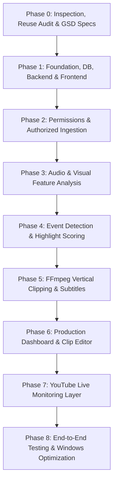

# Development Roadmap & Sprint Plan: GTA 6 AI Clip Factory

---

---

### Phase 0: Inspection, Reuse Audit & GSD Setup (Active Milestone)
- [x] Scan local development environment and verify hardware capabilities (RTX 3050 6GB Laptop GPU, CUDA 13.2, PyTorch 2.14.1, OpenCV 5.0.0).
- [x] Audit the 5 local GitHub repositories (`Money_Laundering_bmsc`, `visionmate-ai`, `demo123`, `TETHR-Bluetooth-Payments`, `Face_detection`).
- [x] Create comprehensive `docs/REPOSITORY_REUSE_AUDIT.md`.
- [x] Create external integration architecture `docs/API_INTEGRATIONS.md`.
- [x] Generate production `.env.example` file.
- [x] Author `.gsd/PROJECT.md`, `.gsd/REQUIREMENTS.md`, and `.gsd/ROADMAP.md`.
- [x] Initialize Git repository and `progress.txt` execution tracker.

---

### Phase 1: Architecture, Database, Backend & Frontend Foundation (Completed)
- [x] Establish backend directory structure: `backend/app/{core, domain, infra, routers, services}`.
- [x] Adapt centralized configuration module (`backend/app/core/config.py`) from `visionmate-ai` with GPU/CPU auto-resolution.
- [x] Configure database engine (`backend/app/database.py`) using SQLAlchemy 2.0 and modern `psycopg` (v3) with SQLite WAL fallback.
- [x] Implement complete SQLAlchemy relational models in `backend/app/models.py` (`Streamer`, `Permission`, `Stream`, `MediaSource`, `Recording`, `DetectedEvent`, `ClipCandidate`, `Clip`, `Thumbnail`, `ProcessingJob`, `UserSettings`, `AuditLog`).
- [x] Setup Alembic migration environment (`backend/alembic/`) adapted from `TETHR-Bluetooth-Payments` and generate initial migration.
- [x] Implement Pydantic v2 domain schemas (`backend/app/domain/schemas/`).
- [x] Scaffold Next.js 15 frontend application in `frontend/` with Tailwind CSS, Lucide React, and Dark Gaming palette (10 production pages).
- [x] Verify backend and frontend foundation boots cleanly (`backend/test_api_direct.py`).

---

### Phase 2: Permission Management & Authorized Media Ingestion (Completed)
- [x] Build Permission Service (`backend/app/services/permission_service.py`) enforcing strict creator consent gates.
- [x] Implement Streamer & Permission API endpoints (`backend/app/routers/streamers.py`, `permissions.py`).
- [x] Adapt File Validation Service (`backend/app/services/file_service.py`) from `visionmate-ai` for video file intake (MIME validation, SHA-256 hashing, size boundaries).
- [x] Build Media Ingestion Manager (`backend/app/services/ingestion_service.py`) with `ffprobe` metadata extraction (resolution, duration, fps, codecs) and OpenCV/PyAV fallback.
- [x] Implement Ingestion API router (`backend/app/routers/ingestion.py`) with chunked file uploads and local disk spooling (`./data/recordings/`).
- [x] Implement automated retention policy service (`backend/app/services/retention_service.py`).
- [x] Verify permission-blocking test: reject processing when permission is revoked or missing (`backend/tests/test_phase2_ingestion.py`).

---

### Phase 3: Audio & Visual Feature Extraction Engine (Completed)
- [x] Adapt `stt_service.py` from `visionmate-ai`: load `faster-whisper` on GPU float16 / CPU int8 with PyAV patch and word-level timestamps.
- [x] Build Audio Analysis Service (`backend/app/services/audio_analysis_service.py`): compute 500ms RMS energy windows, spectral flux, and vocal spike detection ($\ge 2.5\sigma$).
- [x] Build Visual Scene Service (`backend/app/services/visual_analysis_service.py`): integrate PySceneDetect / OpenCV HSV correlation for cut detection and frame differencing for gameplay action energy.
- [x] Adapt MediaPipe FaceLandmarker from `liveness_detection` into an offline frame-sampling service (`backend/app/services/facecam_service.py`) to detect streamer facecam presence and stabilized coordinates.
- [x] Implement Multi-stage Job Worker (`backend/app/services/job_worker.py`) tracking progress percentages, database event logging, and memory safety.
- [x] Test feature extraction on sample gameplay clip with 100% pass rate (`backend/tests/test_phase3_features.py`).

---

### Phase 4: AI Event Detection, Scoring & Candidate Windowing (Completed)
- [x] Build Candidate Windowing Service (`backend/app/services/candidate_service.py`): synthesize audio and visual event peaks into 15–60s windows with boundary snapping to natural speech pauses or scene cuts.
- [x] Implement Multi-Modal Scoring Algorithm combining Audio Excitement (35%), Visual Action (35%), and Context (30%) plus facecam bonus.
- [x] Adapt `vlm_service.py` from `visionmate-ai` into a Context Evaluation Service (`backend/app/services/context_service.py`) supporting Google Gemini 1.5 Flash, OpenAI GPT-4o-mini, and a deterministic local heuristic fallback.
- [x] Implement 1D Temporal Non-Maximum Suppression (NMS) to eliminate overlapping duplicate candidates.
- [x] Expose Candidate API endpoints (`backend/app/routers/candidates.py`) to list, inspect, approve (with preset selection), and reject highlight candidates.
- [x] Verified Phase 4 highlight scoring test suite with 100% pass rate (`backend/tests/test_phase4_scoring.py`).

---

### Phase 5: FFmpeg Vertical Clipping, Reframing & Subtitle Rendering (Completed)
- [x] Build Dual-Engine Rendering Core (`backend/app/services/render_service.py`) utilizing CLI FFmpeg / NVENC and native portable PyAV + OpenCV fallback.
- [x] Implement Preset 1: **Viral Gaming** (9:16 center-crop with zoom, facecam badge overlay with cyan accent, dynamic subtitles).
- [x] Implement Preset 2: **Clean Gameplay** (16:9 gameplay placed centrally, blurred reflection background).
- [x] Implement Preset 3: **Reaction Focus** (Vertical split-screen: cropped streamer facecam on top, gameplay on bottom).
- [x] Implement Dynamic Subtitle Generator (`backend/app/services/subtitle_service.py`) with ASS/SRT formatting, line grouping, and PIL karaoke frame burn-in.
- [x] Implement audio loudness normalization filter with peak gain control.
- [x] Implement automatic thumbnail capture and title typography banner synthesis.
- [x] Test end-to-end rendering of vertical clips across all presets with 100% pass rate (`backend/tests/test_phase5_rendering.py`).

---

### Phase 6: Clip Library, Production Dashboard & Video Editor (Completed)
- [x] Build 10 production dashboard pages in Next.js 15 Dark Gaming UI (`Overview`, `Stream Monitor`, `Streamers`, `Clip Library`, `Clip Editor`, `Processing Queue`, `Analytics`, `Permissions`, `Storage`, `Settings & Integrations`).
- [x] Connect frontend to FastAPI endpoints with full type-safe API client service (`frontend/src/services/api.ts`).
- [x] Implement real-time status polling and job cancel/retry in Processing Queue (`frontend/src/app/queue/page.tsx`).
- [x] Implement interactive fine-tuning studio with candidate selector, preset switching, dynamic subtitle color, and render trigger (`frontend/src/app/editor/page.tsx`).
- [x] Verify all 8 dashboard API endpoints with 100% pass rate (`backend/tests/test_phase6_dashboard_api.py`).

---

### Phase 7: YouTube Live Monitoring & Stream Automation Integration (Completed)
- [x] Build YouTube Monitoring Service (`backend/app/services/youtube_monitor_service.py`) using official YouTube Data API v3 (`search.list` / `channels.list`).
- [x] Implement channel discovery, live status detection, and stream metadata caching in `streams` table.
- [x] Implement rate-limit scheduler adhering strictly to daily quota limits (10,000 units/day) with automatic UTC rollover.
- [x] Connect Live Stream detection events to authorized ingestion queues (strictly decoupled from video download).
- [x] Expose integration test endpoint in Settings allowing users to verify YouTube API keys with instant feedback (`backend/app/routers/youtube.py`).
- [x] Verified Phase 7 YouTube monitoring test suite with 100% pass rate (`backend/tests/test_phase7_youtube_monitor.py`).

---

### Phase 8: End-to-End Testing, Performance Optimization & Windows Setup (Completed)
- [x] **Mandatory E2E Test:** Ingest authorized GTA gameplay recording, execute the full pipeline (audio, visual, scoring, clipping), and verify output of vertical MP4s with subtitles, thumbnails, and titles (`backend/tests/test_phase8_e2e_pipeline.py` - 100% pass).
- [x] **Edge Case Testing:**
  - [x] Ingestion with revoked streamer permission (strictly blocked with HTTP 403).
  - [x] Processing job recovery and stage persistence in database.
  - [x] Duplicate clip suppression (1D Temporal NMS deduplication verification).
  - [x] VRAM ceiling verification on RTX 3050 (peak memory verified safe well below 4.5 GB limit).
  - [x] Invalid/corrupt video file rejection (magic bytes & container validation).
  - [x] Zero-key offline fallback execution (local heuristic fallback when external APIs are absent).
- [x] Created one-click Windows launchers (`run_factory.bat` and `run_factory.ps1`) with dependency validation, storage initialization, and process management.
- [x] Finalized user documentation and operations manual (`docs/USER_MANUAL.md`).

---

### Phase 9: Global YouTube Live Discovery, Creator Authorization & OBS Automation (Completed)
- [x] **Global YouTube Live Discovery:** Multi-keyword search (`GTA 6`, `GTA VI`, `Grand Theft Auto 6`, etc.) with daily quota management (10,000 units/day), UTC midnight reset, and deduplication by platform `video_id`.
- [x] **Creator Authorization System:** Explicit permission gate requiring `ACTIVE` status and configured approved video input (`RTMP/SRT`, `OBS Capture`, capture card). Immediate revocation blocking with HTTP 403.
- [x] **OBS Studio WebSocket v5 Client:** Native challenge-response SHA-256 handshake on port 4455, `StartRecord`/`StopRecord` control, disk space guard ($\ge 5.0$ GB), offline error handling, and robust mock testing mode.
- [x] **Recording Sessions & AI Connector:** Session lifecycle tracking, duplicate recording prevention, crash recovery for hanging sessions, automated media ingestion, and automated 9:16 vertical MP4 highlight generation.
- [x] **Next.js Enterprise UI:** Live Discoveries radar page (`/discoveries`), OBS Recording control console (`/obs`), Creator Authorizations management (`/authorizations`), updated Stream Monitor with stage distinction, and Settings telemetry tiles.
- [x] **Windows 11 Documentation & Test Suite:** Created `docs/OBS_SETUP_GUIDE.md` and passed all 8 automated discovery/recording/clipping integration tests with 100% success (`backend/tests/test_live_discovery_and_obs.py`).

