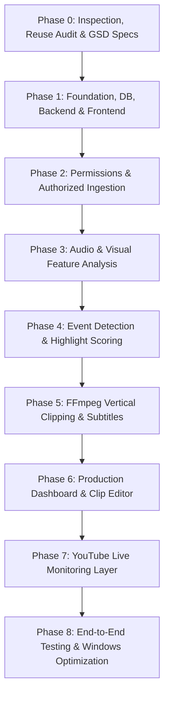

# Development Roadmap & Sprint Plan: GTA 6 AI Clip Factory

---

---

### Phase 0: Inspection, Reuse Audit & GSD Setup (Active Milestone)
- [x] Scan local development environment and verify hardware capabilities (RTX 3050 6GB Laptop GPU, CUDA 13.2, PyTorch 2.14.1, OpenCV 5.0.0).
- [x] Audit the 5 local GitHub repositories (`Money_Laundering_bmsc`, `visionmate-ai`, `demo123`, `TETHR-Bluetooth-Payments`, `Face_detection`).
- [x] Create comprehensive `docs/REPOSITORY_REUSE_AUDIT.md`.
- [x] Create external integration architecture `docs/API_INTEGRATIONS.md`.
- [x] Generate production `.env.example` file.
- [x] Author `.gsd/PROJECT.md`, `.gsd/REQUIREMENTS.md`, and `.gsd/ROADMAP.md`.
- [x] Initialize Git repository and `progress.txt` execution tracker.

---

### Phase 1: Architecture, Database, Backend & Frontend Foundation
- [ ] Establish backend directory structure: `backend/app/{core, domain, infra, routers, services}`.
- [ ] Adapt centralized configuration module (`backend/app/core/config.py`) from `visionmate-ai` with GPU/CPU auto-resolution.
- [ ] Configure database engine (`backend/app/database.py`) using SQLAlchemy 2.0 and modern `psycopg` (v3).
- [ ] Implement complete SQLAlchemy relational models in `backend/app/models.py` (`Streamer`, `Permission`, `Stream`, `MediaSource`, `Recording`, `DetectedEvent`, `ClipCandidate`, `Clip`, `Thumbnail`, `ProcessingJob`, `UserSettings`, `AuditLog`).
- [ ] Setup Alembic migration environment (`backend/alembic/`) adapted from `TETHR-Bluetooth-Payments` and generate initial migration.
- [ ] Implement Pydantic v2 domain schemas (`backend/app/domain/schemas/`).
- [ ] Scaffold Next.js 15 frontend application in `frontend/` with Tailwind CSS, Lucide React, and Dark Gaming palette.
- [ ] Verify backend and frontend foundation boots cleanly.

---

### Phase 2: Permission Management & Authorized Media Ingestion
- [ ] Build Permission Service (`backend/app/services/permission_service.py`) enforcing strict creator consent gates.
- [ ] Implement Streamer & Permission API endpoints (`backend/app/routers/streamers.py`, `permissions.py`).
- [ ] Adapt File Validation Service (`backend/app/services/file_service.py`) from `visionmate-ai` for video file intake (MIME validation, SHA-256 hashing, size boundaries).
- [ ] Build Media Ingestion Manager (`backend/app/services/ingestion_service.py`) with `ffprobe` metadata extraction (resolution, duration, fps, codecs).
- [ ] Implement Ingestion API router (`backend/app/routers/ingestion.py`) with chunked file uploads and local disk spooling (`./data/recordings/`).
- [ ] Implement automated retention policy service (`backend/app/services/retention_service.py`).
- [ ] Verify permission-blocking test: reject processing when permission is revoked or missing.

---

### Phase 3: Audio & Visual Feature Extraction Engine
- [ ] Adapt `stt_service.py` from `visionmate-ai`: load `faster-whisper` on GPU float16 with PyAV patch and word-level timestamps.
- [ ] Build Audio Analysis Service (`backend/app/services/audio_analysis_service.py`): compute 500ms RMS energy windows, spectral flux, and vocal spike detection ($\ge 2.5\sigma$).
- [ ] Build Visual Scene Service (`backend/app/services/visual_analysis_service.py`): integrate PySceneDetect for cut detection and OpenCV frame differencing for gameplay action energy.
- [ ] Adapt MediaPipe FaceLandmarker from `liveness_detection` into an offline frame-sampling service (`backend/app/services/facecam_service.py`) to detect streamer facecam presence and stabilized coordinates.
- [ ] Implement Background Job Manager (`backend/app/services/job_service.py`) tracking progress percentages and memory safety.
- [ ] Test feature extraction on sample gameplay clip.

---

### Phase 4: AI Event Detection, Scoring & Candidate Windowing
- [ ] Build Candidate Windowing Service (`backend/app/services/candidate_service.py`): synthesize audio and visual event peaks into 15–60s windows with boundary snapping to natural speech pauses or scene cuts.
- [ ] Implement Multi-Modal Scoring Algorithm combining Audio Excitement (35%), Visual Action (35%), and Context (30%).
- [ ] Adapt `vlm_service.py` from `visionmate-ai` into a Context Evaluation Service (`backend/app/services/context_service.py`) supporting Google Gemini 1.5 Flash, OpenAI GPT-4o-mini, and a deterministic local heuristic fallback.
- [ ] Implement Temporal Non-Maximum Suppression (NMS) to eliminate overlapping duplicate candidates.
- [ ] Expose Candidate API endpoints (`backend/app/routers/candidates.py`) to list, inspect, and approve highlight candidates.

---

### Phase 5: FFmpeg Vertical Clipping, Reframing & Subtitle Rendering
- [ ] Build FFmpeg Rendering Core (`backend/app/services/render_service.py`) utilizing static FFmpeg binaries and NVENC hardware acceleration.
- [ ] Implement Preset 1: **Viral Gaming** (9:16 smart center-crop with motion tracking, zoomed gameplay, prominent subtitles).
- [ ] Implement Preset 2: **Clean Gameplay** (16:9 gameplay placed centrally, blurred reflection top and bottom).
- [ ] Implement Preset 3: **Reaction Focus** (Vertical split-screen: cropped streamer facecam on top, gameplay on bottom).
- [ ] Implement Dynamic ASS Subtitle Generator (`backend/app/services/subtitle_service.py`) with word-by-word karaoke-style highlighting.
- [ ] Implement two-pass EBU R128 audio loudness normalization filter (`loudnorm`).
- [ ] Implement automatic thumbnail capture and title synthesis.
- [ ] Test end-to-end rendering of a vertical clip.

---

### Phase 6: Clip Library, Production Dashboard & Video Editor
- [ ] Build 10 production dashboard pages in Next.js:
  1. `Overview` (production stats, active jobs, hardware utilization)
  2. `Stream Monitor` (streamer cards, live status badges, capture triggers)
  3. `Streamers` (creator roster, profile links, permission indicators)
  4. `Clip Library` (searchable/filterable media gallery with video preview)
  5. `Clip Editor` (interactive waveform trimmer, preset switcher, subtitle editor)
  6. `Processing Queue` (real-time progress bars, stage status, cancel/retry)
  7. `Analytics` (Recharts score distribution, generation speed, yield charts)
  8. `Permissions` (creator consent audit, grant/revoke actions)
  9. `Storage` (disk usage breakdown, retention policies, 1-click purge)
  10. `Settings & Integrations` (API keys, hardware mode, preset defaults)
- [ ] Connect frontend to FastAPI endpoints with full CRUD capabilities.
- [ ] Implement real-time status polling / SSE for active render jobs.

---

### Phase 7: YouTube Live Monitoring & Stream Automation Integration
- [ ] Build YouTube Monitoring Service (`backend/app/services/youtube_monitor_service.py`) using official YouTube Data API v3 (`videos.list` / `search.list`).
- [ ] Implement channel discovery, live status detection, and stream metadata caching.
- [ ] Implement rate-limit scheduler adhering strictly to daily quota limits.
- [ ] Connect Live Stream detection events to authorized ingestion queues (strictly decoupled from video download).
- [ ] Expose integration test endpoint in Settings allowing users to verify YouTube API keys with instant feedback.

---

### Phase 8: End-to-End Testing, Performance Optimization & Windows Setup
- [ ] **Mandatory E2E Test 1:** Ingest a 10-minute authorized GTA gameplay recording, execute the full pipeline (audio, visual, scoring, clipping), and verify output of multiple vertical MP4s with subtitles, thumbnails, and titles.
- [ ] **Edge Case Testing:**
  - Ingestion with revoked streamer permission (must block).
  - Processing job recovery after simulated crash.
  - Duplicate clip suppression (NMS verification).
  - VRAM ceiling verification on RTX 3050 (ensure peak memory remains < 4.5 GB).
  - Invalid/corrupt video file rejection.
  - Zero-key offline fallback execution.
- [ ] Create one-click Windows launcher (`run_factory.bat` / `run_factory.ps1`).
- [ ] Finalize user documentation and operation manual.
