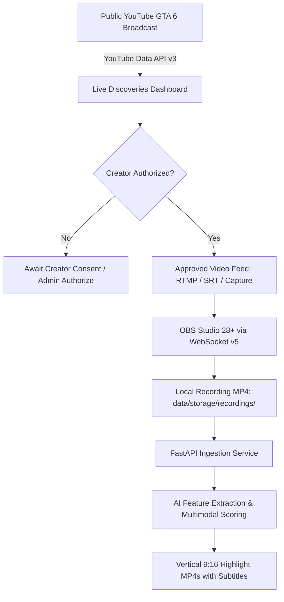

# OBS Studio Integration & Windows Setup Guide
**Automated Broadcast Recording & Hardware Capture for GTA 6 AI Clip Factory**

---

## 1. Architectural Overview & Boundaries

The **GTA 6 AI Clip Factory** integrates directly with **OBS Studio 28+** using its native **WebSocket protocol v5** on port `4455`.

### Core Safety & Platform Principles
- **Authorized Feeds Only:** OBS Studio records authorized creator video inputs (e.g., creator-provided RTMP/SRT feeds, capture devices, or approved capture scenes).
- **Zero Scraping & Zero DRM Bypass:** The YouTube Data API v3 handles global live stream discovery and metadata monitoring. Video ingestion never scrapes or bypasses protected YouTube livestreams.
- **Hands-Free Automation:** When a discovered livestream belongs to an authorized creator with a configured input feed, the application automatically tells OBS to start recording, tracks health and duration, stops recording when the stream ends, ingests the video, and triggers AI highlight clip generation.



---

## 2. Windows 11 Laptop Setup (Dell G15-5530 / RTX 3050)

### Step 1: Install or Update OBS Studio
Ensure OBS Studio **28.0 or higher** is installed (OBS 28+ includes WebSocket v5 built-in):
- Official Download: [https://obsproject.com/](https://obsproject.com/)

### Step 2: Enable OBS WebSocket Server
1. Launch OBS Studio.
2. In the top navigation bar, click **Tools** → **WebSocket Server Settings**.
3. Check **Enable WebSocket server**.
4. Set **Server Port** to `4455` (default).
5. *(Optional but Recommended)* Check **Enable Authentication** and create a secure password (e.g., `Gta6ClipFactoryPass123`).
6. Click **Apply**, then **OK**.

### Step 3: Configure Video Recording Output
1. In OBS Studio, click **Settings** (bottom-right) → **Output**.
2. Set **Output Mode** to **Advanced**.
3. Navigate to the **Recording** tab:
   - **Type:** Standard
   - **Recording Path:** `C:\Users\dell\OneDrive\Desktop\YT STREAMING\backend\data\storage\recordings` (or your preferred local storage drive).
   - **Recording Format:** `mp4` (or `mkv` with remux).
   - **Video Encoder:** **NVIDIA NVENC H.264** (takes advantage of your GeForce RTX 3050 Laptop GPU for zero-lag hardware encoding).
   - **Rate Control:** `CBR` or `CQC` (6,000 Kbps - 10,000 Kbps recommended for 1080p).
   - **Audio Encoder:** `AAC` (192 Kbps).
4. Click **Apply**, then **OK**.

---

## 3. Adding an Authorized Creator Feed Scene

In OBS Studio:
1. Under **Scenes**, create a scene named:
   `GTA6_Authorized_Stream`
2. Under **Sources**, add an approved input source:
   - **For Creator RTMP / SRT Stream:** Click **+** → **Media Source** → Uncheck *Local File* → Enter the authorized stream URL in *Input* (e.g., `rtmp://127.0.0.1:1935/live/streamer` or `srt://...`). Check *Restart playback when source becomes active*.
   - **For Local Game / Capture Card:** Click **+** → **Game Capture** or **Video Capture Device** (Elgato / Cam Link).
3. Ensure the scene canvas resolution is `1920x1080` at 30 or 60 FPS in **Settings** → **Video**.

---

## 4. Connecting with the Application

Configure your local `.env` file with your OBS WebSocket credentials:

```env
# --- OBS Studio WebSocket v5 Integration ---
OBS_HOST="127.0.0.1"
OBS_PORT=4455
OBS_PASSWORD="Gta6ClipFactoryPass123"
OBS_ENABLED=True
MAX_RECORDING_DURATION_MINUTES=30
MIN_DISK_FREE_SPACE_GB=5.0
AUTO_RECORD_AUTHORIZED=True
AUTO_PROCESS_AFTER_RECORDING=True
```

### Verifying Connection
1. Launch the application with `run_factory.bat` or `run_factory.ps1`.
2. Open the web UI at `http://localhost:3000`.
3. Navigate to **OBS Recording** (`/obs`).
4. Click **Reconnect OBS**.
5. The status badge will display **ONLINE (v30.x)** with green indicators for connection, disk storage buffer, and standby state.

---

## 5. End-to-End Hands-Free Recording Workflow

1. **Global Discovery:** The YouTube service searches for active GTA 6 broadcasts across YouTube every 3 minutes.
2. **Authorization Gate:**
   - In **Live Discoveries** (`/discoveries`), if a creator is not yet registered, click **Authorize Creator**.
   - Input the approved video feed name (e.g., `OBS:WindowCapture_GTA6` or `rtmp://...`).
   - The creator status becomes `ACTIVE` (`AUTHORIZED`).
3. **Automated Recording:**
   - The automation service detects the authorized live stream, checks disk space ($\ge 5\text{ GB}$ free), and commands OBS to begin recording immediately.
   - Recording progress and duration appear in the **Stream Monitor** and **OBS Control Hub**.
4. **Automated Finalization:**
   - When the stream ends or reaches the 30-minute safety limit, OBS stops recording.
   - The recorded MP4 is registered into PostgreSQL/SQLite via the Ingestion Service.
   - The AI highlight pipeline runs automatically:
     - Faster-Whisper audio transcription.
     - Vocal excitement burst detection ($\ge 2.5\sigma$).
     - HSV scene cuts and gameplay action motion energy.
     - MediaPipe facecam tracking.
     - Multimodal highlight candidate scoring & temporal NMS.
     - 1080x1920 vertical video rendering with dynamic subtitles and thumbnails.
   - Finished clips are immediately visible in your **Clip Library** (`/clips`) for preview, download, and fine-tuning.
