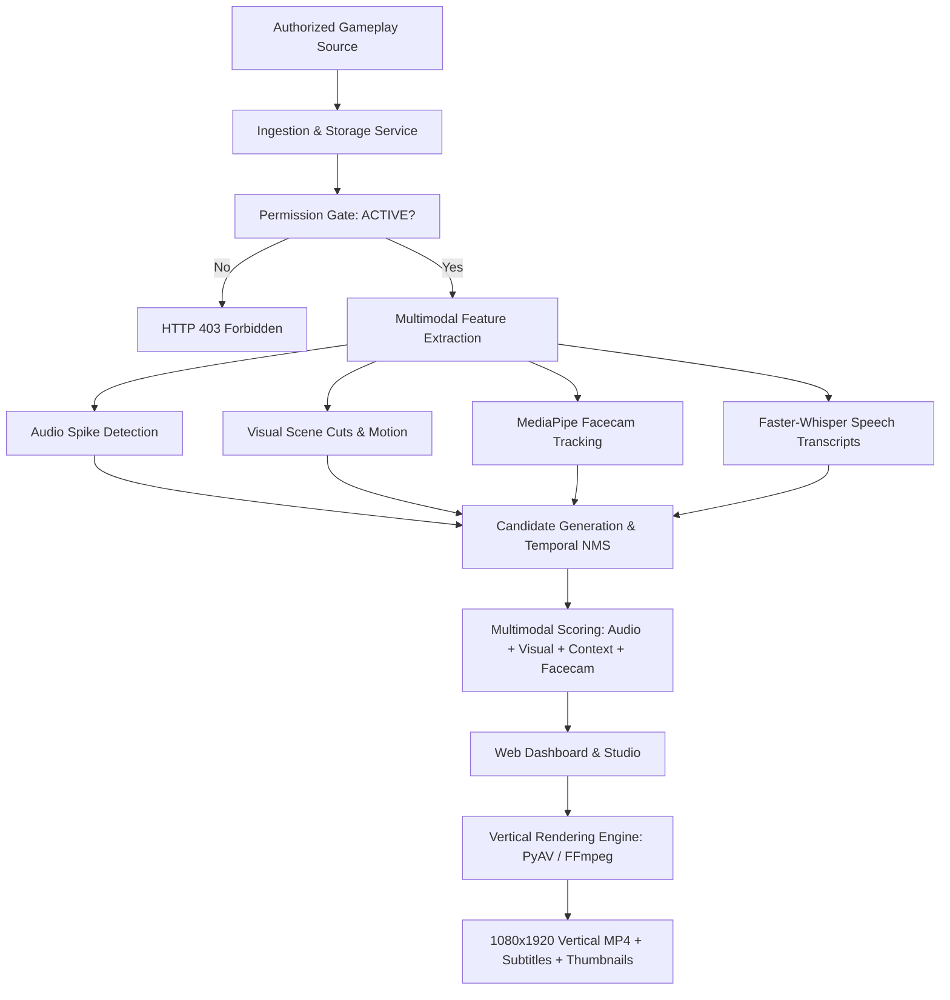

# GTA 6 AI Clip Factory - User Operations Manual
**Automated Highlight Extraction, Multimodal Scoring & Vertical Video Rendering for GTA 6 Streamers**

---

## 1. System Overview & Architecture

**GTA 6 AI Clip Factory** is a specialized, production-grade video intelligence and vertical video generation studio built for GTA 6 creators and video editors. The application ingests long-form authorized gameplay broadcasts, analyzes audiovisual features (vocal excitement spikes, high-motion gameplay sequences, facecam tracking, and speech transcription), scores candidate moments with multimodal heuristics or VLM reasoning, and renders polished **9:16 vertical MP4s (1080x1920)** with dynamic karaoke subtitles, optimized framing presets, and high-CTR thumbnails.

### Core Architecture Principles
- **Zero Automatic Social Media Publishing:** Output videos are stored strictly on local storage (`backend/data/storage/clips/`). All downloads and distribution decisions remain 100% in human control.
- **Strict Permission Gating:** A stream cannot be ingested or processed unless the creator has an explicit `ACTIVE` permission record in the database. Revoked or expired permissions immediately halt all pipeline operations with HTTP 403 Forbidden.
- **Zero Scraping / No DRM Bypass:** Ingestion accepts only authorized local video files or user-provided feeds. YouTube live monitoring uses only the official YouTube Data API v3 REST endpoints.
- **Hardware-Conscious Design:** Optimized for mid-range gaming workstations (e.g., NVIDIA GeForce RTX 3050 6GB Laptop GPU), maintaining a peak VRAM ceiling under 4.5 GB with automatic fallback to CPU.



---

## 2. System Requirements & Hardware Profile

| Component | Minimum Requirement | Recommended (Target Setup) |
| :--- | :--- | :--- |
| **Operating System** | Windows 10/11 64-bit | Windows 11 64-bit |
| **Processor** | 6-Core Intel i5 / AMD Ryzen 5 | 8-Core Intel i7 / AMD Ryzen 7 |
| **System RAM** | 16 GB | 16 GB - 32 GB |
| **GPU / Acceleration** | CPU Fallback supported | NVIDIA GeForce RTX 3050 (6GB VRAM) or higher |
| **Python** | Python 3.10+ | Python 3.10+ (PyTorch 2.14+, PyAV 19+, OpenCV 5+) |
| **Node.js** | Node.js 18+ | Node.js 20+ (Next.js 15, React 19) |
| **FFmpeg** | Not required (PyAV embedded) | System FFmpeg (optional acceleration) |

---

## 3. Quick Start Guide (One-Click Launchers)

The application includes two preconfigured Windows desktop launchers in the root directory:

### Option A: Standard Batch Launcher (`run_factory.bat`)
Double-click `run_factory.bat` in File Explorer or run from Command Prompt:
```cmd
run_factory.bat
```
*The script verifies Python and Node.js, ensures storage directories exist, installs frontend dependencies if needed, starts the FastAPI backend (port 8000), starts the Next.js UI (port 3000), and opens `http://localhost:3000` in your default browser.*

### Option B: PowerShell Launcher (`run_factory.ps1`)
Right-click `run_factory.ps1` and select **Run with PowerShell**, or execute:
```powershell
powershell -ExecutionPolicy Bypass -File .\run_factory.ps1
```
*Provides color-coded startup diagnostics, verifies PyTorch GPU acceleration status, launches independent console windows for backend and frontend, and opens the Studio UI.*

---

## 4. Creator Onboarding & Permission Gating

Before any stream or video can be ingested, the streamer must be registered and granted an active permission.

### Onboarding a Creator
1. Open the dashboard at `http://localhost:3000`.
2. Navigate to **Streamers** (`/streamers`).
3. Click **Add Streamer**.
4. Enter:
   - **Display Name:** e.g., `MiamiViceGamer`
   - **Platform:** `YouTube` or `Twitch`
   - **Channel ID:** e.g., `UC_SAMPLE_CHANNEL_ID`
   - **Channel URL:** e.g., `https://youtube.com/@MiamiViceGamer`
5. Click **Save Streamer**.

### Granting Permission
1. Click on the streamer or navigate to **Permissions** (`/permissions`).
2. Click **Grant Permission**.
3. Select the streamer, grant type (`manual` or `oauth`), and scope (`clip_creation` or `full_access`).
4. Enter authorization notes (e.g., `Written consent via email on 2026-11-15`).
5. Click **Authorize**. The permission status changes to **ACTIVE**.

> [!IMPORTANT]
> If a streamer's permission is set to `REVOKED` or `EXPIRED`, the backend pipeline will reject any ingestion or clip rendering requests for that creator with `HTTP 403 Forbidden`.

---

## 5. Authorized Video Ingestion Workflow

GTA 6 AI Clip Factory strictly processes authorized video files.

### Ingestion Methods
1. **Direct Web Upload:**
   - Navigate to **Ingestion** (`/ingest`).
   - Select the authorized streamer from the dropdown.
   - Drag and drop your gameplay recording (`.mp4`, `.mov`, `.mkv`).
   - The file service calculates SHA-256 hashes, validates magic bytes to prevent malformed files, and stores the recording in `backend/data/storage/recordings/`.
2. **Local Path Ingestion (Fast for large files):**
   - Place long recordings (e.g., 2–4 hour stream files) into a local folder.
   - Use the backend API `POST /api/v1/ingest/local` passing `streamer_id` and `source_path`.
   - The engine analyzes container metadata, audio tracks, and video duration without copying if desired.

---

## 6. Multi-Modal Feature Extraction Engine

Once a recording is ingested, a `feature_extraction` job processes the broadcast through 4 parallel/sequential stages:

1. **Audio Excitement Detection (`AudioAnalysisService`):**
   - Samples 500ms sliding RMS energy windows.
   - Calculates baseline mean and standard deviation.
   - Identifies vocal bursts, shouts, and loud reactions exceeding $2.5\sigma$ above the running baseline.
2. **Visual Action & Scene Cut Detection (`VisualAnalysisService`):**
   - Analyzes HSV color histograms across frames to detect camera cuts and hard scene transitions.
   - Computes grayscale frame differencing motion energy to isolate high-speed car chases, firefights, and explosive gameplay.
3. **Facecam Tracking (`FacecamService`):**
   - Utilizes Google MediaPipe `FaceLandmarker` (`face_landmarker.task`).
   - Samples frames across four candidate corners to detect static streamer webcam overlays.
   - Computes bounding box stability, aspect ratio, and face presence percentage.
4. **Speech Transcription (`STTService`):**
   - Transcribes stream audio using `faster-whisper` (`base` or `small` model).
   - Generates word-level timestamps used for snapping highlight boundaries and creating dynamic animated subtitles.

---

## 7. AI Highlight Scoring & Candidate Generation

Highlight candidates are synthesized through an intelligent scoring pipeline:

1. **Temporal Windowing & Snapping:**
   - Centers candidate windows around peak audio and visual energy moments.
   - Default target clip duration: 15 to 60 seconds (ideal ~30s).
   - Snaps start and end times to the nearest scene cut (within 2s) and speech sentence pauses to avoid clipping mid-word or mid-sentence.
2. **Temporal Non-Maximum Suppression (NMS):**
   - Compares overlapping candidate windows using 1D temporal Intersection over Union ($\text{IoU}$).
   - Any candidate overlapping with a higher-scoring candidate with $\text{IoU} \ge 0.30$ is deduplicated.
3. **Multimodal Scoring Formula:**
   $$\text{Composite Score} = (0.35 \times S_{\text{audio}}) + (0.35 \times S_{\text{visual}}) + (0.30 \times S_{\text{context}}) + \text{Facecam Bonus (0.05)}$$
4. **VLM Context Evaluation (`ContextService`):**
   - If configured with an OpenAI API key or Google Gemini API key, sends transcript segments and feature scores for contextual entertainment evaluation and catchy title generation.
   - **Local Heuristic Fallback:** If external API keys are absent or network is unavailable, the service automatically falls back to an offline heuristic analyzer that grades pacing, action density, and transcript sentiment with zero external dependencies.

---

## 8. Vertical Video Rendering Studio & Presets

In the **Clip Studio** (`/editor` or `/clips`), choose any candidate and select from 3 professional framing presets:

| Preset Name | Layout Description | Best Used For |
| :--- | :--- | :--- |
| **Viral Gaming** *(Default)* | **Split-Screen:** Streamer facecam cropped and anchored in the top 35% of the frame; zoomed 9:16 gameplay action fills the bottom 65%. | High-energy streams with streamer facecam reactions. |
| **Clean Gameplay** | **Focused Dynamic Crop:** High-resolution 9:16 crop centered on gameplay action with subtle blurred background bars for full FOV. | Pure gameplay, vehicular chases, cinematic missions without webcam. |
| **Reaction Focus** | **Picture-in-Picture:** Full 9:16 cinematic gameplay canvas with circular or rounded facecam overlay placed in the top corner. | Narrative moments, game dialogues, reaction highlights. |

### Dynamic Karaoke Subtitles
- Renders high-visibility animated gaming subtitles with yellow active word highlight, white base text, black stroke outline, and drop shadow.
- Fully rendered using high-performance Pillow drawing directly onto video frames, ensuring crisp rendering across any operating system without external font server dependencies.

### Loudness Normalization
- All audio is normalized to a target loudness of **-1.0 dBFS**, preventing clipping and ensuring uniform volume across all generated clips.

### High-CTR Thumbnail Generation
- For every rendered clip, the engine automatically extracts the peak action frame, composites title typography, and saves a high-resolution 1080x1920 JPEG linked to the clip.

---

## 9. Official YouTube Data API v3 Live Monitoring

The application includes an official live status monitor:

1. **Configuration:** Set `YOUTUBE_API_KEY` in `.env`.
2. **Live Discovery:** The monitor polls `search.list` with `eventType=live` and `type=video` filtered by the streamer's channel ID.
3. **Quota Tracking:** A strict `YouTubeQuotaTracker` tracks daily API points against the standard 10,000 unit limit and automatically resets at midnight UTC.
4. **Decoupled Architecture:** The monitor logs stream start times and titles into the database. Video files must be provided via authorized ingestion feeds.

---

## 10. Local Storage Hierarchy & Video Export

All files are stored in organized local subdirectories under `backend/data/`:

```
backend/data/
├── gta6_clip_factory.db       # SQLite WAL database (all metadata & tables)
├── models/
│   └── face_landmarker.task   # MediaPipe face tracking model
├── storage/
│   ├── recordings/            # Source broadcast gameplay files
│   ├── clips/                 # Finished 1080x1920 vertical MP4s
│   └── thumbnails/            # 1080x1920 primary JPEG thumbnails
└── temp/                      # Working frames and scratch files
```

### Manual Download & Preview
- In the dashboard **Clips** tab, preview any clip with the integrated HTML5 video player.
- Click **Download MP4** to save the vertical highlight to your local disk.
- Click **Download Thumbnail** to get the 1080x1920 cover image.

---

## 11. Hardware Optimization & Troubleshooting

### RTX 3050 VRAM Management
- The application is calibrated for 6GB GPUs (such as the RTX 3050 Laptop GPU).
- Torch operations are allocated dynamically and cached memory is cleared after feature extraction jobs to stay under the 4.5 GB safety limit.
- If CUDA out-of-memory occurs, switch `TORCH_DEVICE=cpu` in `.env` to engage resilient multithreaded CPU processing.

### Embedded Dual-Engine Rendering
- If `ffmpeg.exe` is installed on your system PATH, the renderer uses hardware-accelerated CLI NVENC encoding.
- If FFmpeg is not in PATH, the renderer automatically switches to native embedded **PyAV** (`av 19.0+`), generating vertical MP4s with bundled H.264 libraries and zero setup required.

### Database Connection Fallback
- The system attempts to connect to PostgreSQL at `POSTGRES_SERVER:5432`.
- If PostgreSQL is not running, it automatically falls back without delay to the high-performance local SQLite WAL database at `backend/data/gta6_clip_factory.db`.
